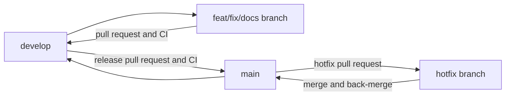

# Contributing

Thanks for helping improve ReuseAtlas. Keep the skill portable and focused on evidence-backed reuse decisions.

## Branch workflow

`main` contains production-ready releases. `develop` is the integration branch. Work starts from `develop` on a focused feature or maintenance branch; open a pull request back to `develop`. Release pull requests go from `develop` to `main`. Hotfixes start from `main`, merge back to `main`, then are incorporated into `develop`.



Do not commit directly to `main` or `develop`; use pull requests. Branch protections should require pull requests and passing CI without requiring reviewer approvals for this single-maintainer repository.

## Before opening a change

- Check existing issues and avoid duplicating ongoing work.
- Keep the canonical skill under `skills/reuse-atlas/`.
- Do not add agent-specific command syntax to the core workflow unless it belongs in host-specific installation documentation.
- Do not copy third-party code without checking its license and preserving required notices.
- Do not add network calls that run when the skill loads. Helpers should make network requests only when explicitly invoked.

## Local checks

Python 3.10+ is needed for the optional GitHub helper. Run:

```sh
python skills/reuse-atlas/scripts/validate_skill.py
python -m unittest discover -s tests -v
```

For behavioral changes, update `evals/cases.md` and describe what must be reviewed manually. Do not present structural checks as proof that a host agent followed the research workflow correctly.

## Pull requests

Explain the user-facing problem, the change, and the evidence used to verify it. Keep examples clearly labeled when illustrative. Include links for claims about external projects or host compatibility.
