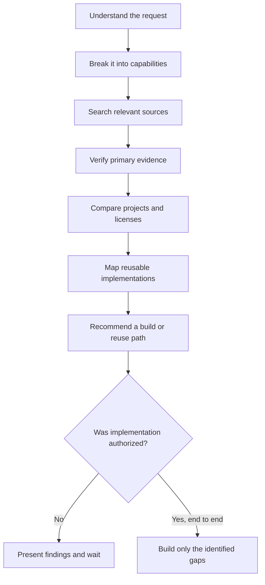

# ReuseAtlas

**Map what exists. Reuse what works. Build what matters.**

ReuseAtlas is a portable Agent Skill for researching existing software before an agent builds a new product or substantial feature. It helps turn a list of search results into an evidence-backed decision: what to use, integrate, harvest, adapt, or build.

## Why it exists

Coding agents can start implementing from a short prompt before checking whether a useful implementation already exists. Finding a similar project is only the first step: its feature may be planned rather than shipped, its license may not fit, or it may not expose an integration point. ReuseAtlas asks the agent to verify candidates and map specific reusable capabilities before recommending a direction.

## How the workflow works



Search is bounded by default (six initial queries, five candidates, eight primary sources). The skill reports scope and limitations; it never claims exhaustive internet coverage. Discovery is read-only and candidate content is treated as untrusted input.

## Example

Suppose a user wants a self-hosted team knowledge base with login, Markdown editing, full-text search, and file attachments. A generic search summary might return three project names. ReuseAtlas instead checks which capabilities each project actually implements and produces a map such as:

| Capability | Candidate evidence | Reuse route | Recommendation |
|---|---|---|---|
| Markdown editor | Inspected editor package and documented API | Dependency | Integrate after checking framework compatibility |
| Full-text search | Search module found in repository source | Source component or service | Verify indexing and license before adoption |
| Authentication | Candidate documents OIDC, but implementation was not inspected | Unknown | Do not count as available yet |
| Attachments | No suitable inspected implementation | Build gap | Design storage and access control |

This table is illustrative, not a claim about named projects. Actual reports link to the evidence inspected and close with one explicit recommendation.

## Install

The canonical skill is `skills/reuse-atlas/` in this repository. Copy the folder to a host's skill directory.

### Codex

Global installation:

```sh
mkdir -p ~/.agents/skills
cp -R skills/reuse-atlas ~/.agents/skills/reuse-atlas
```

Project-local installation: copy it to `<project>/.agents/skills/reuse-atlas/`.

### Claude Code

Global installation:

```sh
mkdir -p ~/.claude/skills
cp -R skills/reuse-atlas ~/.claude/skills/reuse-atlas
```

Project-local installation: copy it to `<project>/.claude/skills/reuse-atlas/`.

On Windows, use the equivalent copy command in PowerShell. Keep the folder name `reuse-atlas` so it matches the skill metadata.

### Other Agent Skills hosts

Copy the same folder into the host's documented skill discovery directory, or include the `SKILL.md` instructions manually where the host has no skill loader. Discovery directories and automatic activation vary by host.

## Use

Ask for a project or substantial feature, for example:

> Use ReuseAtlas before we build a self-hosted URL shortener. Compare existing implementations and show exactly what we can integrate.

The skill conducts research and reports a decision before implementation. Autonomous implementation continues only when the user has already authorized end-to-end work.

## Optional GitHub search fallback

Native search and repository-reading tools are preferred. If a host lacks them, the optional helper can return structured repository metadata from GitHub's public Search API. It does not clone or execute candidate code and makes no network request until explicitly run.

```sh
python skills/reuse-atlas/scripts/github_search.py "self-hosted URL shortener" --limit 10
```

Set `GITHUB_TOKEN` in the environment to use an optional token and GitHub's authenticated rate limits. Never place tokens in source files or command history. The helper only searches GitHub; inspect primary sources and other relevant ecosystems separately. A failed request exits nonzero and emits a JSON error to stderr.

## Scope and limitations

- Results depend on the host's search coverage, available source access, and the bounded research budget.
- Search results and repository metadata are discovery leads, not proof that a feature works.
- Compatibility, production readiness, security, and license fit require human judgment and project-specific verification.
- The GitHub helper reports metadata only; it is not a quality score or exhaustive search.
- **Codex CLI:** automatic discovery and activation were exercised in Codex CLI `0.171.0-alpha.13.2` across 14 read-only scenarios. Several evidence-depth cases remain partial; see the [evaluation record](evals/results.md). This is one configuration, not a guarantee across Codex versions or app surfaces.
- **Claude Code:** the skill was copied to the documented global directory and Claude Code `2.1.329` was present, but its CLI required sign-in. Activation was not behaviorally verified.
- Other Agent Skills hosts are expected to work where their loader follows the format, but have not been tested here. Host support and installation paths vary.
- License notes are informational and are not legal advice.

This repository is published as **`1.0.0-rc.1`** while source-level evidence and license-citation behavior receive further validation. Do not interpret the release candidate as cross-agent behavioral certification.

## Development

Requirements: Python 3.10+ for the helper; the tests use only the Python standard library.

```sh
python skills/reuse-atlas/scripts/validate_skill.py
python -m unittest discover -s tests -v
```

The checks validate skill structure and helper behavior. Behavioral evaluations require running the scenarios in [`evals/cases.md`](evals/cases.md) with real agent hosts and recording evidence; these have not been claimed as passed.

## Contributing and security

See [CONTRIBUTING.md](CONTRIBUTING.md) for local checks and contribution guidance, and [SECURITY.md](SECURITY.md) to report a vulnerability. Please review any external repository before adapting its code and honor its license.

## License

ReuseAtlas is released under the [MIT License](LICENSE).
