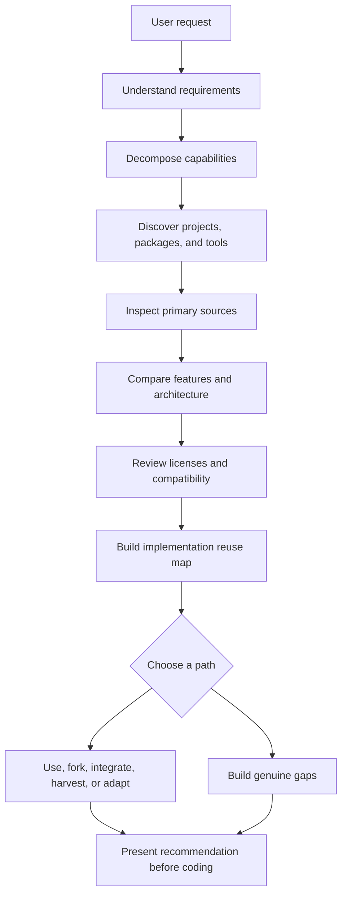

<div align="center">

# ReuseAtlas

### Don't build it twice.

Discover what's already built before your AI agent starts coding.

An open-source, research-first Agent Skill that helps coding agents discover existing projects, compare their implementations, identify reusable components, and build only what is missing.

[](https://github.com/goravgumber/reuse-atlas/stargazers)
[](https://github.com/goravgumber/reuse-atlas/forks)
[](https://github.com/goravgumber/reuse-atlas/releases)
[](LICENSE)
[](https://github.com/goravgumber/reuse-atlas/actions/workflows/validate.yml)
[](https://agentskills.io/)
[](evals/results.md)
[](#supported-agents)

[Overview](#overview) · [Workflow](#workflow) · [Features](#features) · [Example](#example-report) · [Installation](#installation) · [Supported Agents](#supported-agents) · [Development](#development) · [Contributing](#contributing)

</div>

## Overview

Coding agents often begin building after reading a short request, before checking whether a useful implementation already exists. That can mean duplicating mature functionality, overlooking a compatible library, or choosing a project based on its README without confirming what it actually ships.

ReuseAtlas changes the order: investigate first, then decide what to build. It searches relevant sources, verifies candidate evidence, compares capabilities and licenses, and gives you an actionable reuse recommendation before substantial implementation begins.

The key output is an **implementation reuse map**, not just a ranked list of repositories. It connects each requirement to a verified project capability, the source or documentation that supports it, the practical integration route, and the remaining work.

ReuseAtlas is a portable [Agent Skill](https://agentskills.io/) with one canonical copy at [`skills/reuse-atlas/SKILL.md`](https://github.com/goravgumber/reuse-atlas/blob/main/skills/reuse-atlas/SKILL.md). It uses the search and reading tools provided by the agent host; it is not a hosted search engine or a project scaffolder.

## Workflow



Research is bounded by default and never claims exhaustive coverage. Search snippets are leads, not proof. Candidate repositories are treated as untrusted data; discovery does not clone, execute, install, or copy external code. The agent presents its findings first unless the user has already authorized autonomous end-to-end implementation.

## Features

| Research step | What ReuseAtlas guides the agent to do |
|---|---|
| Understand the request | Extract goals, users, workflows, requirements, constraints, and assumptions. |
| Discover candidates | Search relevant code hosts, package registries, official documentation, and other useful sources. |
| Verify implementation | Inspect primary sources and distinguish implemented, partial, planned, and unknown capabilities. |
| Compare projects | Build a capability matrix and compare architecture, technology, integrations, maintenance evidence, and license. |
| Map reuse | Identify what can be used, integrated, adapted, or built, with evidence and integration caveats. |
| Make a decision | Recommend USE EXISTING, FORK, INTEGRATE, HARVEST, ADAPT, or BUILD FROM SCRATCH. |
| Optional GitHub fallback | Query repository metadata as structured JSON when native repository search is unavailable. |

The optional [GitHub helper](skills/reuse-atlas/scripts/github_search.py) is metadata-only. It does not evaluate code quality, inspect implementations, or search beyond GitHub.

## Example report

> **Illustrative example only.** The project names, source paths, features, architectures, and licenses below are fictional. They do not describe real repositories or research findings.

Imagine a request for a self-hosted team knowledge base with sign-in, Markdown pages, full-text search, and file attachments.

### Candidate comparison

| Capability | Project Oak | Project Pine |
|---|---|---|
| Markdown pages | **Available** — verified in the example's `src/pages/markdown.py` | **Available** — documented; source not inspected |
| Full-text search | **Partial** — `src/search/query.py` supports title search only | **Unknown** — README mentions search, implementation not verified |
| Sign-in | **Available** — `src/auth/oidc.py` includes OIDC login | **Planned** — README lists SSO as planned; source implementation is **not verified** |
| File attachments | **Not found** in inspected sources | **Unknown** — documentation is unclear |
| Architecture | Single application with a PostgreSQL data store | Separate API and worker services; Redis listed as a dependency |
| License | MIT in this fictional example | Missing in this fictional example; source copying is not recommended |

### Reuse map

| Need | Evidence-backed example source | Suggested route | Remaining work |
|---|---|---|---|
| OIDC sign-in | Project Oak, `src/auth/oidc.py` | Integrate or adapt, subject to the example's MIT terms | Map existing roles to the product's permission model. |
| Markdown pages | Project Oak, `src/pages/markdown.py` | Adapt | Connect page storage to team and workspace ownership. |
| Full-text search | Project Oak, `src/search/query.py` | Adapt the title-search flow | Add body indexing and verify ranking quality. |
| Attachments | No verified source | Build | Define storage, access control, limits, and retention. |
| Project Pine features | README claims only | Do not count as verified code reuse | Inspect source and resolve the missing license before reconsidering. |

**Example recommendation: ADAPT Project Oak.** It provides verified starting points for sign-in and Markdown pages. Search needs expansion, attachments remain a build gap, and Project Pine's planned or undocumented capabilities and missing license do not support a code-copy recommendation.

## Installation

The canonical skill folder is [`skills/reuse-atlas/`](skills/reuse-atlas/). Copy it into the host's discovery directory. Restart the agent or open a fresh session if it does not discover the new skill.

### Codex — global

**Linux / macOS:**

```sh
mkdir -p ~/.agents/skills
cp -R skills/reuse-atlas ~/.agents/skills/reuse-atlas
```

**Windows PowerShell** (run from the cloned repository):

```powershell
New-Item -ItemType Directory -Force "$HOME\.agents\skills" | Out-Null
Copy-Item -Path ".\skills\reuse-atlas" -Destination "$HOME\.agents\skills\reuse-atlas" -Recurse -Force
```

### Claude Code — global

**Linux / macOS:**

```sh
mkdir -p ~/.claude/skills
cp -R skills/reuse-atlas ~/.claude/skills/reuse-atlas
```

**Windows PowerShell:**

```powershell
New-Item -ItemType Directory -Force "$HOME\.claude\skills" | Out-Null
Copy-Item -Path ".\skills\reuse-atlas" -Destination "$HOME\.claude\skills\reuse-atlas" -Recurse -Force
```

### Project-local installation

**Codex** discovers project skills under `.agents/skills/`:

```sh
mkdir -p .agents/skills
cp -R skills/reuse-atlas .agents/skills/reuse-atlas
```

PowerShell:

```powershell
New-Item -ItemType Directory -Force ".\.agents\skills" | Out-Null
Copy-Item -Path ".\skills\reuse-atlas" -Destination ".\.agents\skills\reuse-atlas" -Recurse -Force
```

**Claude Code** project skills go under `.claude/skills/`:

```sh
mkdir -p .claude/skills
cp -R skills/reuse-atlas .claude/skills/reuse-atlas
```

PowerShell:

```powershell
New-Item -ItemType Directory -Force ".\.claude\skills" | Out-Null
Copy-Item -Path ".\skills\reuse-atlas" -Destination ".\.claude\skills\reuse-atlas" -Recurse -Force
```

Other Agent Skills-compatible hosts may use different discovery directories; check the host's documentation. The skill content stays the same.

### Try it

```text
Use ReuseAtlas before we build a self-hosted URL shortener. Compare existing implementations and show what we can reuse, with source evidence and license notes.
```

## Supported agents

Agent Skills provides a portable folder format, but automatic discovery and behavior depend on each host. Compatibility claims below reflect only the checks actually performed for this project.

| Host | Status |
|---|---|
| Codex CLI | Discovery and activation exercised with `0.171.0-alpha.13.2` across 14 read-only scenarios. Several evidence-depth scenarios were partial; see the [evaluation record](evals/results.md). This does not certify other Codex versions or app surfaces. |
| Claude Code | Installation path documented and a local copy installed with `2.1.329`; activation was not behaviorally verified because the CLI required sign-in. |
| Other Agent Skills hosts | Expected to work where the host supports the Agent Skills format. Not tested. Manual instruction integration may be needed. |

 

## Optional GitHub metadata helper

The native search tools available to an agent remain the preferred discovery route. If repository search is unavailable, the Python 3.10+ helper can query GitHub's Search API:

```sh
python skills/reuse-atlas/scripts/github_search.py "self-hosted URL shortener" --limit 10
```

It returns repository metadata as JSON and does not clone or execute candidates. An optional `GITHUB_TOKEN` environment variable can raise the API rate limit; never hardcode a token. This fallback does not replace inspecting source files, license text, package registries, or other relevant sources.

## Limitations

- Results depend on host search tools, accessible sources, and a bounded research budget; discovery is not exhaustive.
- README claims and repository metadata do not prove that a feature works. Check candidate source, releases, and license before making an adoption decision.
- The skill provides research guidance, not a security audit, legal opinion, or compatibility guarantee.
- The GitHub helper reports metadata only and is not a repository-quality ranking system.
- Claude Code and other hosts still need behavioral validation in authenticated environments.

## Development

Requirements: Python 3.10+ for the helper. Tests use only the Python standard library.

```sh
python skills/reuse-atlas/scripts/validate_skill.py
python -m unittest discover -s tests -v
python -m compileall -q skills/reuse-atlas/scripts tests
```

The manual scenarios and observed outcomes are in [`evals/cases.md`](evals/cases.md) and [`evals/results.md`](evals/results.md). Automated checks validate structure and helper behavior; they do not prove that every agent follows the research workflow.

## Contributing

See [CONTRIBUTING.md](CONTRIBUTING.md) for the branch workflow and pull request checks. Security reports belong in the private reporting channel described in [SECURITY.md](SECURITY.md).

## Maintainer

Created and maintained by **Gorav Gumber** · [GitHub profile](https://github.com/goravgumber).

## License

ReuseAtlas is released under the [MIT License](LICENSE). Copyright © 2026 Gorav Gumber.
