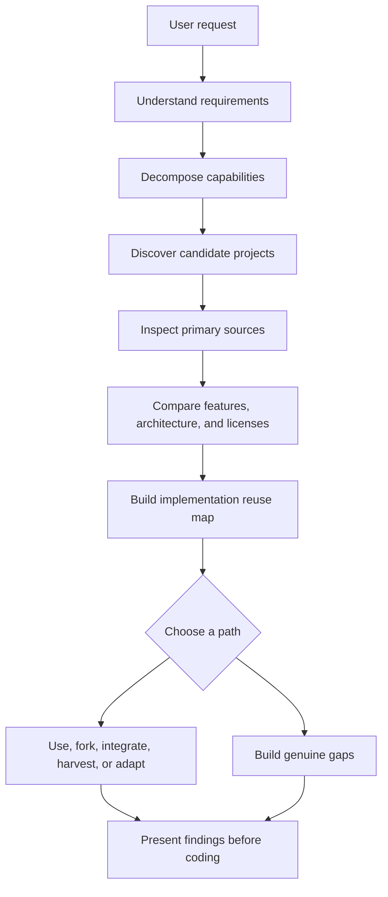

<div align="center">

# ReuseAtlas

### Don't build it twice.

Discover what's already built before your AI agent starts coding.

An open-source, research-first Agent Skill for comparing existing implementations and deciding what to reuse before building a substantial project.

[](https://github.com/goravgumber/reuse-atlas)
[](https://github.com/goravgumber/reuse-atlas/forks)
[](https://github.com/goravgumber/reuse-atlas/releases)
[](LICENSE)
[](https://github.com/goravgumber/reuse-atlas/actions/workflows/validate.yml)
[](https://agentskills.io/)
[](evals/results.md)
[](#supported-agents)

[Overview](#overview) · [Live demonstration](#see-reuseatlas-in-action) · [Workflow](#workflow) · [Installation](#installation) · [Evaluations](#evaluations) · [Development](#development)

</div>

## Overview

Coding agents can start implementing a project before checking whether useful software already exists. ReuseAtlas guides the agent to discover candidate projects, inspect primary sources, compare capabilities and licenses, then map the reusable parts and remaining work.

Its central output is an **implementation reuse map**: a source-backed account of what can be used, integrated, adapted, or built, with compatibility gaps and license notes. Research is bounded and read-only; it is not an exhaustive search engine or project scaffolder.

ReuseAtlas is a portable [Agent Skill](https://agentskills.io/) with one canonical copy at [`skills/reuse-atlas/SKILL.md`](skills/reuse-atlas/SKILL.md). It uses search and reading tools supplied by the host agent.

## Workflow



## Features

| Step | What the skill guides the agent to do |
|---|---|
| Understand | Identify users, capabilities, constraints, and assumptions. |
| Discover | Search relevant code hosts, packages, and official documentation. |
| Verify | Inspect primary sources and distinguish implemented, partial, planned, and unknown. |
| Compare | Review features, architecture, stack, deployment, maintenance evidence, and license. |
| Map reuse | Name source-backed components, integration routes, risks, and remaining work. |
| Recommend | Choose USE EXISTING, FORK, INTEGRATE, HARVEST, ADAPT, or BUILD FROM SCRATCH. |

## See ReuseAtlas in action

The original request was:

> I want to build a self-hosted URL shortener with custom domains, analytics, QR codes, user authentication and an admin dashboard. Use ReuseAtlas first. Search for existing open-source projects, inspect their actual implementations, compare their features, technology stacks and licenses, and show exactly what we can reuse. Do not start coding yet. Complete the research and present the findings first.

The discovery compared four public projects:

| Project | What the research found | License |
|---|---|---|
| [Kutt](https://github.com/thedevs-network/kutt) | README documents custom domains, link management, private statistics, OIDC login, user management, an admin page, REST API, and self-hosting. | MIT |
| [Shlink](https://github.com/shlinkio/shlink) | REST API, CLI, domain-aware links, visit tracking, API-key authentication, and separate web clients. In v5, the old `/{shortCode}/qr-code` route was removed; QR generation remains available in client-side logic. | MIT |
| [Dub](https://github.com/dubinc/dub.link) | TypeScript monorepo with a Next.js application and link-management API; the repository has AGPLv3 content and specified enterprise-licensed paths. | Mixed; inspect files individually |
| [YOURLS](https://github.com/YOURLS/YOURLS) | PHP shortener with admin interface, statistics, API, plugin hooks, and community QR-code plugins. | MIT |

### Capability snapshot

“Unknown” means the reviewed evidence did not establish the implementation. README claims are documented capabilities, not source-verified code paths.

| Capability | Kutt | Shlink | Dub | YOURLS |
|---|---|---|---|---|
| Self-hosting | Available | Available | Available | Available |
| Custom domains | Available, documented | Available | Available, documented | Partial; own domain supported, multi-domain management not verified |
| Analytics | Available, documented | Available | Available, documented | Available |
| QR codes | Unknown in reviewed source | Partial; old endpoint removed in v5, client logic remains | Unknown in reviewed source | Partial; community plugins |
| User authentication | Available, documented (OIDC) | Partial; API-key authentication, not end-user login | Available, documented | Partial; private admin login, multi-user model not verified |
| Admin dashboard | Available, documented | Partial; separate web client | Available, documented | Available |
| API | Available | Available | Available | Available |

### Reuse map and recommendation

- **Kutt — provisional application base.** Its README covers the broadest match to the requested app. Before forking or copying components, inspect the actual auth, authorization, dashboard, and data-model files; the demo did not verify all those implementation paths.
- **Shlink — API and visit-analytics reference.** Its v5 upgrade notes are the primary source for the QR endpoint change. Do not interpret endpoint removal as proof that every QR-generation capability disappeared.
- **YOURLS — plugin-extension reference.** Its plugin catalog documents QR plugins; this is an extension-pattern reference rather than verified core QR code to copy.
- **Dub — architectural reference.** Review its mixed license at file level before any reuse.

The report's verdict was **ADAPT Kutt**, with these remaining tasks: verify Kutt's auth and authorization implementation; add or confirm QR generation; define custom-domain ownership and verification; decide analytics detail and privacy requirements; and identify missing admin operations.

**Evidence limit:** Kutt's specific README claims were recorded as documented capabilities. The demo did not establish code-level reuse paths for all capabilities, nor did it run any candidate project. Read the [complete research report](docs/examples/url-shortener-discovery.md) for source links, architecture notes, license detail, gaps, and evidence limitations.

> This is a real Codex Desktop demonstration from 27 November 2026. The skill was explicitly invoked. It demonstrates the discovery and reporting workflow; it does not certify automatic activation, exhaustive discovery, or source-level verification of every candidate capability.

## Installation

Copy `skills/reuse-atlas/` into the host's skill discovery directory. Restart the agent or open a fresh session if it does not discover the skill.

### Codex — global

**Linux / macOS:**

```sh
mkdir -p ~/.agents/skills
cp -R skills/reuse-atlas ~/.agents/skills/reuse-atlas
```

**Windows PowerShell** (from the cloned repository):

```powershell
New-Item -ItemType Directory -Force "$HOME\.agents\skills" | Out-Null
Copy-Item -Path ".\skills\reuse-atlas" -Destination "$HOME\.agents\skills\reuse-atlas" -Recurse -Force
```

### Claude Code — global

**Linux / macOS:** `mkdir -p ~/.claude/skills && cp -R skills/reuse-atlas ~/.claude/skills/reuse-atlas`

**Windows PowerShell:**

```powershell
New-Item -ItemType Directory -Force "$HOME\.claude\skills" | Out-Null
Copy-Item -Path ".\skills\reuse-atlas" -Destination "$HOME\.claude\skills\reuse-atlas" -Recurse -Force
```

For project-local installation, Codex uses `.agents/skills/` and Claude Code uses `.claude/skills/`. Other Agent Skills hosts may use different locations; follow their documentation.

### Try it

```text
Use ReuseAtlas before we build a self-hosted URL shortener. Compare existing implementations and show what we can reuse, with source evidence and license notes.
```

## Supported agents

Agent Skills is a portable folder format, but discovery and behavior depend on each host. Compatibility claims below reflect observed checks only.

| Host | Status |
|---|---|
| Codex CLI | Discovery and activation exercised across 14 read-only scenarios on `0.171.0-alpha.13.2`; one fresh-session automatic-activation run also succeeded on 27 November 2026. Some evidence-depth cases were partial. This does not certify other versions or app surfaces. See [evaluation results](evals/results.md). |
| Codex Desktop | One explicitly invoked real-world discovery demonstration; build and model were not captured. Automatic activation is not established. |
| Claude Code | Installation path documented; activation remains unverified because the CLI required sign-in during the prior check. |
| Other Agent Skills hosts | Not tested. |

## Optional GitHub metadata helper

Native host search tools remain the preferred discovery route. If repository search is unavailable, the Python 3.10+ helper can query GitHub's Search API:

```sh
python skills/reuse-atlas/scripts/github_search.py "self-hosted URL shortener" --limit 10
```

It returns repository metadata as JSON. It does not inspect implementations, rank code quality, or replace source and license review. An optional `GITHUB_TOKEN` environment variable can raise the rate limit; never hardcode a token.

## Evaluations

- [Behavioral scenarios](evals/cases.md) — manual prompts and review rubric.
- [Observed results](evals/results.md) — actual host runs, including limitations and partial outcomes.
- [Ecosystem comparison](docs/differentiation.md) — bounded review of adjacent projects.
- [Real URL-shortener demonstration](docs/examples/url-shortener-discovery.md) — full research report.
- [Launch drafts](docs/launch/launch-kit.md) — audience-specific announcement drafts, not posted.

## Limitations

- Findings depend on host search tools, accessible sources, and a bounded research budget; discovery is not exhaustive.
- README claims and repository metadata do not prove that a feature works. Verify candidate source, releases, and license before adoption.
- The skill provides research guidance, not a security audit, legal opinion, or compatibility guarantee.
- Claude Code and other hosts need behavioral validation in authenticated environments.

## Development

Python 3.10+ is required for the optional helper. Tests use the standard library.

```sh
python skills/reuse-atlas/scripts/validate_skill.py
python -m unittest discover -s tests -v
python -m compileall -q skills/reuse-atlas/scripts tests
```

See [CONTRIBUTING.md](CONTRIBUTING.md) for the branch and pull-request workflow. Report vulnerabilities privately as described in [SECURITY.md](SECURITY.md). Release history is in [CHANGELOG.md](CHANGELOG.md).

## Maintainer

Created and maintained by **Gorav Gumber** · [GitHub profile](https://github.com/goravgumber).

## License

ReuseAtlas is released under the [MIT License](LICENSE). Copyright © 2026 Gorav Gumber.
