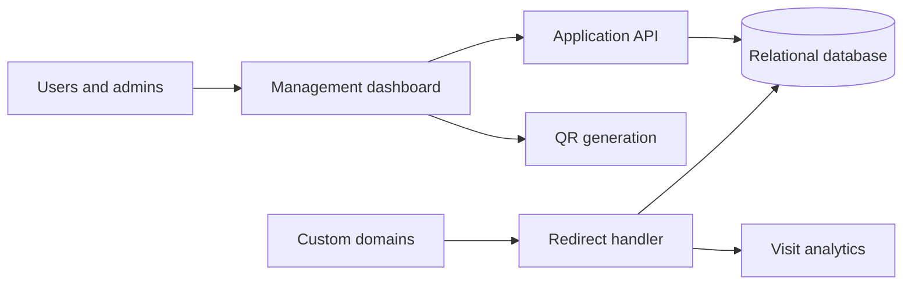

# Real-world discovery demo: self-hosted URL shortener

**Run date:** 27 November 2026
**Host:** Codex Desktop on Windows
**Skill invocation:** Explicit — the user's prompt began “Use ReuseAtlas first.”
**Codex Desktop build and model:** Not captured
**Outcome:** End-to-end discovery demonstration; candidate code was not integrated or tested.

## Original request

> I want to build a self-hosted URL shortener with custom domains, analytics, QR codes, user authentication and an admin dashboard. Use ReuseAtlas first. Search for existing open-source projects, inspect their actual implementations, compare their features, technology stacks and licenses, and show exactly what we can reuse. Do not start coding yet.

The prompt explicitly invoked ReuseAtlas. This run demonstrates the research and reporting workflow; it does not establish that the skill activates automatically when the user does not name it.

## Discovery scope

The report investigated four repositories named in the original output: Kutt, Shlink, Dub, and YOURLS. It included requirement understanding, candidate comparison, architecture and license observations, a reuse map, a suggested architecture, gaps, risks, and the verdict **ADAPT Kutt**. The report was bounded, not an exhaustive search of every shortener.

The following evidence labels keep the README/documentation claims separate from code paths that the demo did not verify:

- **Documented** means the project's README or documentation states the capability.
- **Source inspected** means the report inspected an implementation file or API specification for the claim.
- **Partial** means the capability exists with an important limitation or mismatch.
- **Unknown / not verified** means the inspected evidence did not establish the implementation.
- **Not found** means the capability was not observed in reviewed evidence; it is not proof of absence.

## Candidates and evidence

### Kutt

[Repository](https://github.com/thedevs-network/kutt) · [README](https://github.com/thedevs-network/kutt/blob/main/README.md) · [MIT license](https://github.com/thedevs-network/kutt/blob/main/LICENSE) · [package manifest](https://github.com/thedevs-network/kutt/blob/main/package.json)

Kutt's README documents custom domains, link creation and editing, private statistics, OIDC login, user management, an admin page, a REST API, and self-hosting. The repository layout includes `server/`, `db/`, `static/`, and `docs/api/`; the project is a Node.js application. Its license file is MIT.

**Evidence limit:** The demo did not establish exact source paths for OIDC flows, authorization checks, QR generation, or all admin operations. These are documented features, not fully source-verified component-reuse recommendations. QR support remained unknown in the reviewed evidence.

### Shlink

[Repository](https://github.com/shlinkio/shlink) · [API documentation](https://shlink.io/documentation/api-docs/) · [v5 upgrade notes](https://github.com/shlinkio/shlink/blob/develop/UPGRADE.md) · [MIT license](https://github.com/shlinkio/shlink/blob/develop/LICENSE)

Shlink is a PHP URL-shortening service with a REST API, CLI, domain-aware links, visit tracking, and API-key authentication. Its web client is a separate project. The API documentation describes JSON responses, CORS, date handling, and request tracing.

**QR correction:** Shlink v5 removed the old QR endpoint that was generated by appending `/qr-code` to a short URL, and the route format changed. The upgrade notes refer users to external QR services or QR generation in Shlink's web clients/dashboard. This does **not** mean all QR-generation support disappeared from the Shlink ecosystem.

### Dub

[Repository](https://github.com/dubinc/dub.link) · [README](https://github.com/dubinc/dub.link/blob/main/README.md) · [license text](https://github.com/dubinc/dub.link/blob/main/LICENSE.md) · [link API route](https://github.com/dubinc/dub.link/blob/main/apps/web/app/api/links/route.ts) · [package manifest](https://github.com/dubinc/dub.link/blob/main/package.json)

Dub is a TypeScript monorepo with a Next.js application and link-management API. Its scope includes link management and analytics. The repository license is mixed: the root license says content outside specifically listed paths is AGPLv3, while designated paths use a separate enterprise license. Inspect the exact file and applicable license before considering code reuse; repository-wide metadata alone does not settle every path.

### YOURLS

[Repository](https://github.com/YOURLS/YOURLS) · [admin index](https://github.com/YOURLS/YOURLS/blob/master/admin/index.php) · [configuration](https://github.com/YOURLS/YOURLS/blob/master/includes/Config/Config.php) · [community plugin catalog](https://github.com/YOURLS/awesome/blob/main/README.md) · [MIT license](https://github.com/YOURLS/YOURLS/blob/master/LICENSE)

YOURLS is a PHP shortener using MySQL or MariaDB. Its inspected admin index implements URL listing, searching, filtering, pagination, and click totals, and it exposes plugin hooks. Its configuration defines URL, options, and visit-log tables. The community plugin catalog lists QR-code plugins, so QR is an extension example rather than verified core behavior.

## Capability comparison

| Capability | Kutt | Shlink | Dub | YOURLS |
|---|---|---|---|---|
| Self-hosting | Available, documented | Available | Available, documented | Available |
| Custom domains | Available, documented | Available | Available, documented | Partial: own domain documented; multi-domain management not verified |
| Analytics | Available, documented | Available; visit API documented | Available, documented | Available; admin source includes click totals |
| QR codes | Unknown in reviewed evidence | Partial: old endpoint removed in v5; client logic documented | Unknown in reviewed evidence | Partial: community plugins listed |
| User authentication | Available, documented: OIDC | Partial: API keys; end-user login not verified | Available, documented | Partial: private admin login; multi-user model not verified |
| Admin dashboard | Available, documented | Partial: separate web client | Available, documented | Available; admin source inspected |
| API | Available, documented | Available; API docs inspected | Available; link route inspected | Available, documented |
| License | MIT | MIT | Mixed: AGPLv3 plus separately licensed paths | MIT |

“Not found” or “Unknown” here describes the reviewed evidence, not a definitive absence from the project.

## Architecture and stack comparison

| Project | Architecture and stack | Reuse fit |
|---|---|---|
| Kutt | Node.js service with server, database, static UI, and API documentation in one repository; the repository includes Docker Compose examples. | Closest documented all-in-one starting point for the requested product. Confirm source-level auth, data model, and dashboard behavior before adapting. |
| Shlink | PHP service organized around a REST API and CLI, with separate client applications. | Useful API and visit analytics reference; the client/server boundary means it is not a drop-in dashboard. |
| Dub | TypeScript monorepo containing a Next.js web application and packages. | Broad link-management architecture reference; larger integration surface and mixed-license paths need review. |
| YOURLS | PHP application with MySQL/MariaDB storage, server-rendered admin pages, API, and plugin hooks. | Useful source reference for admin listing and extension design; not the closest documented multi-user product match. |

These are architectural summaries from repository layout, manifests, README/API documentation, and the inspected YOURLS admin code. No candidate was installed or run in this demonstration.

## Implementation reuse map

| Need | Best source | Suggested route | Evidence status and work left | Complexity |
|---|---|---|---|---|
| Short-link application, custom domains | Kutt | Evaluate adapting the complete application | README-level fit and repository structure observed; inspect domain model, routing, and ownership enforcement before copying code. | Medium |
| Visit analytics | Shlink API and Kutt documented stats | Use Shlink as an API/data reference; verify Kutt's implementation if choosing it as base | Shlink API documentation was inspected; Kutt implementation path not verified. Define event detail, retention, and privacy. | Medium |
| QR generation | YOURLS plugin catalog; Shlink client behavior | Add a UI-side QR capability or select and verify a compatible library | QR plugin availability documented for YOURLS; no Kutt QR source verified. Shlink's old server endpoint was removed in v5. | Low–medium |
| Authentication and authorization | Kutt documented OIDC; YOURLS auth source as a limited reference | Prefer Kutt only after inspecting auth flows and access checks | Kutt OIDC is documented, but its relevant source paths were not verified in this demo. Define roles and tenant boundaries. | Medium–high |
| Admin dashboard | Kutt documented admin page; YOURLS `admin/index.php` source | Start by evaluating Kutt's UI; use YOURLS as a reference for listing/search/filter patterns | Kutt UI paths not verified; YOURLS admin listing and plugin hooks were inspected. Identify global moderation and user operations. | Medium |
| Link API and license-aware architecture | Shlink API docs; Dub link route | Use API patterns as design references; evaluate Dub files individually | Shlink API docs and a Dub route were inspected. Dub's mixed license requires path-by-path review. | Medium–high |

Code-level recommendations are intentionally limited where relevant source files were not inspected. README and docs support documented-capability claims, not assertions that a specific file can be copied safely.

## Recommended architecture from the demo

The report proposed adapting a single application base, with custom domains resolved by the redirect handler, visit events recorded for analytics, and QR generation exposed from the UI. It did not establish final component APIs or data schemas.

## Remaining work and risks

- Inspect Kutt's actual authentication, authorization, link, domain, and admin implementation before forking or copying code.
- Add or confirm QR generation and decide whether generated images are stored or created on demand.
- Define custom-domain verification, ownership, and user assignment.
- Set the analytics fields, retention, and privacy rules.
- Identify missing admin actions such as user suspension, moderation, and global usage reporting.
- Check dependency compatibility, maintenance evidence, deployment requirements, and security before choosing a base.
- Preserve notices for MIT code. For Dub, inspect each file's license and seek legal review for consequential use; this report is not legal advice.

## Final recommendation

**ADAPT Kutt** as the provisional application starting point because its README documents the broadest match to the requested feature set and its repository includes both server and UI components. The evidence is not sufficient to recommend copying its authentication, QR, or admin implementation files without further inspection. Use Shlink as an API and analytics reference, YOURLS for plugin-extension patterns, and Dub selectively as an architectural reference after file-level license review.

This was a successful end-to-end discovery demonstration with **partial implementation-evidence completeness**. It is not proof of production fitness, integration, automatic skill activation, exhaustive search, or source verification of every capability.
